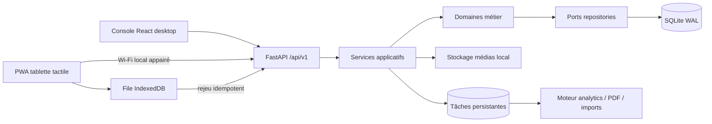
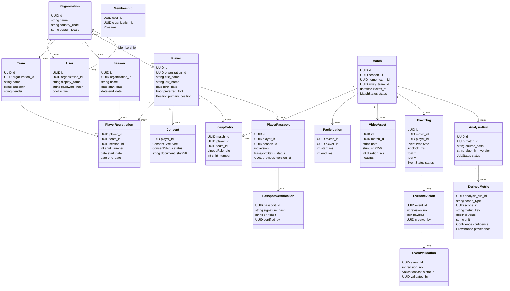
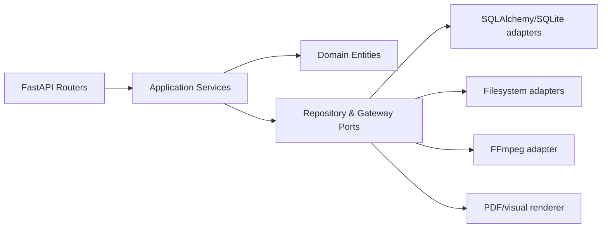
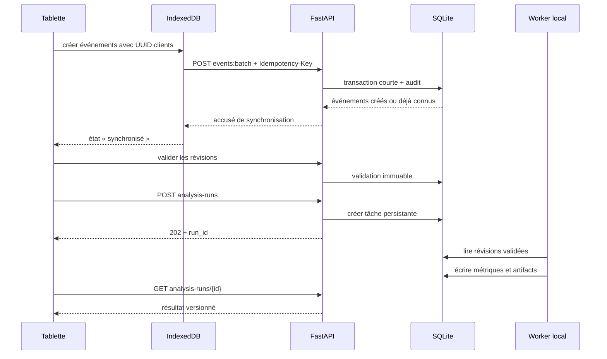

# StatX Analytics — Conception consolidée du MVP réel

**Date :** 30 octobre 2026  
**Statut :** conception technique validée par sections, en attente des références UI/UX et de l’approbation finale  
**Produit :** StatX Analytics — Assistant d’analyse tactique et de performance pour le football  
**Dépôt :** `statx-analytics`

## 1. Sources et contexte

Cette conception consolide :

- la spécification produit « StatX Analytics — Spécification produit et plan de mise en œuvre.pdf » ;
- l’état actuel du monorepo React/FastAPI/SQLite ;
- les décisions validées pendant l’atelier de conception ;
- la contrainte d’un fonctionnement hors ligne ;
- l’usage futur sur tablette tactile ;
- la nécessité de produire des résultats traçables et vérifiables.

La spécification produit d’origine se trouve à :

`C:\Users\MSI\Desktop\StatX Analytics — Spécification produit et plan de mise en œuvre.pdf`

Le prototype actuel possède déjà des briques utiles : FastAPI, React/Vite, SQLite, import et découpage vidéo, premières visualisations, rapport PDF et expérimentations de tracking. Il ne possède cependant pas encore les fondations nécessaires à un produit réel : organisation, saisons, rôles, compositions, validation et versionnement des événements, provenance, consentement, passeport certifié, audit, licence, sauvegarde ou internationalisation complète.

## 2. Intention

StatX Analytics doit permettre à un club de transformer ses données locales — effectif, vidéo, événements manuels et données physiques — en analyses tactiques et passeports joueurs vérifiables, sans dépendre d’Internet.

Le premier produit ne cherche pas à démontrer une intelligence artificielle spectaculaire. Il cherche à rendre un match réellement exploitable de bout en bout :

1. inscrire les joueurs ;
2. préparer un match et sa composition ;
3. importer la vidéo ;
4. taguer les événements ;
5. corriger et valider les observations ;
6. calculer des métriques explicables ;
7. publier un passeport et un rapport certifiés ;
8. sauvegarder et restaurer l’ensemble en sécurité.

## 3. Utilisateurs

### 3.1 Administrateur du club

Configure l’organisation, les utilisateurs, les saisons, les équipes, la licence, les sauvegardes et les restaurations.

### 3.2 Analyste

Prépare les matchs, importe les vidéos, tague les événements, corrige et valide les données, lance les analyses et prépare les publications.

### 3.3 Entraîneur

Consulte les matchs, les analyses, les rapports et les passeports. Selon les droits accordés, il peut créer certains événements ou annotations.

### 3.4 Lecteur

Consulte uniquement les contenus autorisés.

## 4. Objectifs

- Fonctionner entièrement sans connexion Internet.
- Couvrir le flux réel « effectif → match → vidéo → tagging → validation → analyse → passeport ».
- Assurer la traçabilité de chaque métrique et publication.
- Prévenir la perte de données pendant une coupure réseau ou un arrêt brutal.
- Fournir une console analyste efficace sur ordinateur.
- Fournir un mode tactile adapté aux tablettes.
- Prendre en charge le français et l’arabe RTL.
- Produire un rapport PDF d’une page et un passeport vérifiable.
- Intégrer des données physiques provenant de capteurs tiers.
- Permettre une sauvegarde et une restauration chiffrées.

## 5. Non-objectifs du MVP

- Tracking automatique YOLO/ByteTrack en production.
- Identification automatique des joueurs.
- Homographie automatique et reconstruction complète des trajectoires.
- Télémétrie temps réel.
- Synchronisation cloud multi-sites.
- Microservices ou infrastructure distribuée.
- Application mobile native séparée.
- Modèles prédictifs avancés sans sources validées.

Les prototypes de vision existants sont conservés comme module expérimental, isolé du parcours critique.

## 6. Anti-objectifs

Le MVP serait considéré comme un échec s’il :

- produit des statistiques sans indiquer leur source ;
- écrase silencieusement les corrections précédentes ;
- perd des tags lors d’une coupure de la tablette ;
- exige Internet pour taguer, analyser ou générer un rapport ;
- expose le serveur du club sur le réseau sans activation explicite ;
- mélange l’identité permanente d’un joueur avec son inscription saisonnière ;
- publie le passeport d’un mineur sans consentement valide ;
- transforme l’interface tablette en réduction illisible de l’interface desktop ;
- rend le produit inutilisable lorsque la licence expire au lieu de passer en lecture seule.

## 7. Contraintes

- Monorepo existant React/Vite + FastAPI + SQLite.
- Windows est une plateforme prioritaire pour le pilote.
- Les médias sont stockés localement sur le poste du club.
- Les cibles tactiles mesurent au minimum 48 × 48 pixels CSS.
- Les opérations principales sont utilisables en français et en arabe RTL.
- L’accès tablette s’effectue sur le réseau local du club.
- Les calculs et les formats d’export doivent être versionnés.
- Les données personnelles et celles des mineurs exigent des permissions et un audit explicites.

### 7.1 Dimensionnement de référence du pilote

Le dimensionnement fonctionnel retenu pour les tests de charge est un club comportant jusqu’à 10 équipes, 1 000 joueurs historiques, 2 000 matchs et 1 000 000 d’événements validés. Le stockage vidéo peut atteindre plusieurs téraoctets et reste donc géré séparément des performances transactionnelles de SQLite. Les trajectoires de tracking automatique ne font pas partie de ce dimensionnement MVP.

## 8. Approches étudiées

### 8.1 Monolithe modulaire React + FastAPI + SQLite — retenu

Un seul produit local, avec des modules métier séparés et des contrats explicites.

**Avantages :**

- réutilise l’investissement existant ;
- conserve l’écosystème Python pour la vidéo, les statistiques et les rapports ;
- déploiement local simple ;
- testabilité des domaines ;
- migration incrémentale ;
- compatible avec une future tablette PWA.

**Compromis :**

- demande une discipline stricte entre modules ;
- les traitements longs nécessitent une file persistante interne ;
- SQLite impose des transactions courtes et une gestion claire des écritures concurrentes.

### 8.2 Réécriture TypeScript/Tauri — rejetée

Le packaging desktop serait cohérent, mais la réécriture ferait perdre les briques Python et déplacerait le risque vers une migration technique sans bénéfice métier immédiat.

### 8.3 Electron + backend Python — rejetée

Cette approche accélérerait le packaging, mais augmenterait la consommation mémoire et offrirait une trajectoire tablette moins propre.

## 9. Architecture générale



### 9.1 Frontend

- React/Vite conservé.
- Nouvelles fonctionnalités écrites en TypeScript.
- Migration progressive des composants JavaScript utiles.
- React Router pour la navigation.
- TanStack Query pour l’état serveur.
- Dexie/IndexedDB pour les commandes offline.
- i18next pour le français, l’arabe et le RTL.
- Zod pour valider les contrats côté client.
- Tailwind et primitives accessibles pour le système d’interface.
- Animations fonctionnelles courtes, avec respect de `prefers-reduced-motion`.

### 9.2 Backend

Le backend reste un monolithe déployable en une unité, organisé par domaines :

- `identity` : utilisateurs, rôles et sessions ;
- `organizations` : clubs, équipes et saisons ;
- `roster` : joueurs, inscriptions et consentements ;
- `matches` : matchs, compositions et participations ;
- `media` : vidéos, clips et streaming ;
- `tagging` : événements, révisions et validations ;
- `analytics` : runs, métriques, visuels et insights ;
- `physical_data` : imports et mesures physiques ;
- `passports` : versions, sources et certifications ;
- `reports` : PDF et QR ;
- `platform` : audit, licence, tâches, sauvegarde et diagnostic.

Les routes API appellent les services applicatifs. Elles n’accèdent jamais directement à SQLAlchemy ou au système de fichiers.

### 9.3 Persistance

- SQLite avec foreign keys activées.
- Mode WAL et `busy_timeout` configuré.
- Alembic comme source unique des migrations.
- Chemins médias relatifs à une racine configurée.
- SHA-256, type MIME et taille stockés pour chaque artifact.
- Écritures de fichiers temporaires puis remplacement atomique.
- Réessai borné sous Windows lorsqu’un antivirus ou un indexeur verrouille temporairement un fichier.

### 9.4 Distribution Windows et initialisation

Le pilote est livré sous forme d’un installateur Windows. Le frontend compilé est servi par FastAPI. Le backend, les migrations et les outils nécessaires sont regroupés dans un exécutable Python packagé ; FFmpeg est fourni comme dépendance identifiée et vérifiée. Un lanceur démarre le serveur comme processus utilisateur, attend le health check puis ouvre l’application dans le navigateur par défaut. Un service Windows n’est pas requis pour le premier pilote.

Au premier démarrage, un assistant local obligatoire :

1. crée l’organisation ;
2. crée le premier administrateur ;
3. choisit les répertoires de données et de sauvegarde ;
4. configure la langue et le fuseau horaire ;
5. importe ou active la licence signée ;
6. propose une première sauvegarde de vérification.

L’assistant n’est plus accessible une fois l’installation initialisée, sauf par une procédure de récupération administrateur auditée.

## 10. Vertical Slice 01

Le premier incrément réellement livrable est :

```text
Club et effectif
    → Match et composition
    → Import vidéo
    → Tagging manuel tactile
    → Révision et validation
    → Analyse versionnée
    → Passeport joueur
    → Certification, QR et PDF
```

Cette tranche remplace l’ordre actuel « découpage → tracking IA → ingestion » par un parcours aligné sur la valeur métier.

## 11. Modèle de données

### 11.1 Règles générales

- Identifiants UUID afin de permettre la création offline.
- Dates techniques en UTC.
- Temps vidéo et match en millisecondes entières.
- Coordonnées terrain en mètres, bornées à 105 × 68.
- Révisions, validations, certifications et audits immuables.
- Données calculées séparées des données sources.
- Toute métrique conserve version, provenance et éléments de preuve.
- Toute racine métier appartient à une organisation.

### 11.2 Diagramme de classes métier



### 11.3 Données physiques

- `SensorImportBatch` : fichier, fournisseur, hash, statut et auteur.
- `SensorColumnMapping` : colonne source, métrique cible, unité et conversion.
- `PhysicalSession` : date, type, équipe et éventuel match associé.
- `PhysicalMeasurement` : joueur, métrique, valeur, unité et indicateur qualité.

### 11.4 Analytics et rapports

- `AnalysisRun` fige le hash du jeu de révisions validées et la version du moteur.
- `DerivedMetric` stocke valeur, unité, numérateur, dénominateur, confiance et provenance.
- `TacticalInsight` stocke sévérité, texte et preuves structurées.
- `Visualization` référence un artifact versionné et hashé.
- `Report` référence l’analyse, le passeport, la langue, le template et le PDF.

### 11.5 Alertes tactiques

Une alerte de concentration sur un flanc est produite uniquement si :

- la proportion dépasse 60 % ;
- le dénominateur comprend au moins 15 attaques ;
- le texte affiche le nombre d’actions et le niveau de confiance ;
- le calcul utilise un `AnalysisRun` identifiable.

### 11.6 Provenance et confiance

- **A — vérifiée :** donnée saisie puis validée par un analyste identifié, ou import capteur signé dont le mapping joueur est confirmé.
- **B — dérivée :** donnée calculée exclusivement depuis des sources A avec un algorithme versionné, ou donnée importée partiellement vérifiée.
- **C — indicative :** donnée héritée du prototype, estimation, source incomplète ou observation non validée.

Une certification peut référencer des données B ou C, mais leur niveau reste visible dans le passeport et le rapport. Une donnée C ne doit jamais être présentée comme certitude.

### 11.7 Politique xG du MVP

Le produit ne doit pas inventer une valeur xG. Une valeur xG est publiée uniquement si elle provient :

- d’un fournisseur/import identifié ; ou
- d’un modèle de calcul documenté, versionné et explicitement activé pour l’organisation.

En l’absence de source ou de modèle approuvé, l’API renvoie `null` et l’interface affiche « xG indisponible » au lieu de zéro. Le premier pilote peut utiliser des valeurs importées ; l’ajout d’un modèle xG calibré est une évolution indépendante.

## 12. Classes applicatives



Services principaux :

- `RegisterPlayerService`
- `RegisterPlayerForSeasonService`
- `RecordConsentService`
- `CreateMatchWorkspaceService`
- `ImportMatchVideoService`
- `CreateEventBatchService`
- `ReviseEventService`
- `ValidateEventService`
- `ComputeMatchAnalysisService`
- `BuildPassportDraftService`
- `CertifyPassportService`
- `GenerateReportService`
- `CreateBackupService`
- `RestoreBackupService`

## 13. API `/api/v1`

### 13.1 Session et organisation

| Méthode | Route | Usage |
|---|---|---|
| POST | `/auth/login` | ouvrir une session locale |
| POST | `/auth/logout` | fermer la session |
| GET | `/session` | utilisateur, rôle, organisation et langue |
| GET | `/organizations/current` | configuration du club |
| GET | `/audit-logs` | consulter le journal selon permissions |

### 13.2 Saisons et effectif

| Méthode | Route | Usage |
|---|---|---|
| GET/POST | `/seasons` | lister ou créer les saisons |
| GET/POST | `/teams` | lister ou créer les équipes |
| GET | `/teams/{id}/roster?season_id=` | effectif saisonnier |
| POST | `/players` | créer l’identité d’un joueur |
| POST | `/teams/{id}/registrations` | inscrire un joueur |
| POST | `/players/{id}/consents` | enregistrer une preuve de consentement |

### 13.3 Match Center

| Méthode | Route | Usage |
|---|---|---|
| GET/POST | `/matches` | rechercher ou créer un match |
| GET | `/matches/{id}` | vue complète du match |
| POST | `/matches/{id}/lineup` | enregistrer la composition |
| POST | `/matches/{id}/videos` | importer une vidéo |
| POST | `/videos/{id}/clips` | créer un clip |
| GET | `/media/{id}/stream` | stream avec requêtes Range |

### 13.4 Tagging et validation

| Méthode | Route | Usage |
|---|---|---|
| POST | `/matches/{id}/events:batch` | créer un lot idempotent |
| GET | `/matches/{id}/events` | filtrer les événements |
| POST | `/events/{id}/revisions` | ajouter une correction |
| POST | `/events/{id}/validations` | valider ou rejeter une révision |
| POST | `/matches/{id}/validation:bulk` | valider un lot contrôlé |

### 13.5 Analyses et données physiques

| Méthode | Route | Usage |
|---|---|---|
| POST | `/matches/{id}/analysis-runs` | lancer une analyse |
| GET | `/analysis-runs/{id}` | suivre la tâche |
| GET | `/matches/{id}/analytics?run=latest` | métriques, insights et visuels |
| POST | `/sensor-imports` | importer et prévisualiser un fichier |
| POST | `/sensor-imports/{id}:commit` | valider mapping et import |

### 13.6 Passeports, rapports et exploitation

| Méthode | Route | Usage |
|---|---|---|
| POST | `/players/{id}/passports` | construire un brouillon |
| POST | `/passports/{id}/certifications` | certifier une version |
| GET | `/verify/{qr_token}` | vérifier l’empreinte et le statut |
| POST | `/reports` | générer un PDF FR ou AR |
| POST | `/backups` | créer une sauvegarde chiffrée |
| POST | `/restores` | vérifier puis restaurer une archive |

Le QR d’un passeport contient un identifiant de certificat, sa version et une empreinte signée du document. L’application peut le vérifier localement sans Internet. Une vérification publique hors du réseau du club n’est pas incluse dans le MVP ; elle nécessiterait ultérieurement un service de publication explicitement accepté par le club.

### 13.7 Contrats transversaux

- `Idempotency-Key` sur les lots et commandes rejouables.
- UUID créé côté client pour chaque événement offline.
- `expected_version` sur les agrégats mutables.
- HTTP 409 pour les conflits de concurrence.
- HTTP 202 et identifiant de tâche pour les traitements longs.
- Erreurs `application/problem+json` avec `code`, `detail`, `trace_id` et erreurs de champs.
- Pagination par curseur pour les gros journaux et historiques.

## 14. Flux de données principal



## 15. Expérience frontend

### 15.1 Navigation desktop

- Vue club
- Effectif
- Match Center
- Analyses
- Passeports
- Imports physiques
- Administration

### 15.2 Match Center

Le Match Center est un assistant à étapes persistantes :

1. contexte du match ;
2. composition ;
3. vidéo ;
4. tagging ;
5. validation ;
6. analyse ;
7. publication.

La console desktop affiche simultanément la vidéo, la palette d’événements et la timeline. Les raccourcis clavier restent disponibles.

### 15.3 Mode tablette

- navigation inférieure contextuelle ;
- grands contrôles tactiles ;
- une tâche dominante par écran ;
- tagging optimisé en paysage ;
- effectif et passeport utilisables en portrait ;
- état offline/synchronisé/conflit toujours visible ;
- aucune action destructive uniquement par geste ;
- annulation temporaire après une saisie rapide.

### 15.4 Motion et accessibilité

- 120–180 ms pour boutons et contrôles ;
- 220–300 ms pour panneaux et changements de contexte ;
- aucune animation décorative continue ;
- respect de `prefers-reduced-motion` ;
- contraste lisible ;
- focus clavier visible ;
- aucune fonction uniquement disponible au survol ;
- cibles tactiles d’au moins 48 pixels.

### 15.5 Références UI/UX

La structure et les interactions sont validées. La direction graphique finale reste volontairement ouverte. Les références fournies par le porteur du produit seront annexées à ce document et deviendront la source de vérité pour :

- palette ;
- typographie ;
- iconographie ;
- densité ;
- composants ;
- animations ;
- responsive ;
- présentation des graphiques.

## 16. Offline et synchronisation

- Le poste principal héberge FastAPI, SQLite et les médias.
- Le frontend de production est servi par FastAPI sous la même origine.
- Le mode tablette doit être activé explicitement par un administrateur.
- La tablette est appairée par un code temporaire.
- Les commandes non synchronisées sont stockées dans IndexedDB.
- Les UUID clients et clés d’idempotence empêchent les doublons.
- Un conflit de version n’est jamais résolu silencieusement.
- L’interface présente la donnée locale, la version serveur et une action de résolution.

## 17. Sécurité et confidentialité

- Hash de mot de passe Argon2id.
- Cookie de session HTTP-only et SameSite.
- Protection CSRF.
- Autorisation par organisation et rôle dans les services applicatifs.
- Audit des connexions, validations, certifications, exports et restaurations.
- Serveur lié à `127.0.0.1` par défaut.
- Activation explicite du réseau local pour la tablette.
- Code d’appairage temporaire et révocable.
- Avertissement si le réseau local n’est pas considéré comme fiable.
- Sauvegardes chiffrées par AES-256-GCM avec clé dérivée par Argon2id.
- Consentement valide requis avant publication d’un mineur.
- Le retrait d’un consentement bloque toute nouvelle publication et révoque les liens de consultation actifs. Les versions certifiées antérieures restent dans l’audit, marquées révoquées et absentes des écrans ordinaires.
- Données sensibles absentes des logs.
- Chiffrement complet du disque recommandé sur le poste du club.

## 18. Licence

- État actif : toutes les fonctionnalités autorisées.
- État proche de l’expiration : avertissement non bloquant.
- État expiré : lecture seule, export des données et sauvegarde toujours disponibles.
- Aucun verrouillage empêchant le club de récupérer ses propres données.
- Chaque changement de licence est audité.
- La licence est un document signé par l’éditeur et vérifié localement avec une clé publique embarquée ; aucune connexion réseau n’est nécessaire.
- Le fichier contient l’organisation, les capacités autorisées, la date d’expiration et un identifiant unique.
- L’horloge système anormalement reculée déclenche un avertissement et une vérification administrative, sans supprimer les données.

## 19. Sauvegarde et restauration

Deux profils sont proposés :

- **sauvegarde opérationnelle**, utilisée par défaut : base, configuration, audits, rapports, visualisations, manifestes et clips publiés ;
- **sauvegarde complète** : ajoute les vidéos brutes et peut nécessiter un support externe de grande capacité.

Le manifeste d’une sauvegarde opérationnelle indique explicitement les vidéos brutes non incluses. Leur absence après restauration ne corrompt pas les données, mais les fonctions dépendantes de ces médias restent indisponibles jusqu’à leur rattachement.

### 19.1 Création

1. Bloquer brièvement les nouvelles écritures métier.
2. Créer un snapshot SQLite cohérent avec l’API de backup.
3. Construire le manifeste des médias et artifacts.
4. Calculer les hashes.
5. Chiffrer l’archive.
6. Réouvrir l’archive et vérifier les hashes.
7. Libérer le verrou et présenter l’artifact.

### 19.2 Restauration

1. Extraire dans un dossier temporaire.
2. Déchiffrer et vérifier le manifeste.
3. Tester l’intégrité SQLite.
4. Exécuter les migrations sur la copie.
5. Vérifier les médias.
6. Sauvegarder l’état actuellement installé.
7. Basculer atomiquement.
8. Revenir à l’état précédent si une vérification échoue.

Une archive invalide ne modifie jamais l’installation active.

## 20. Gestion des erreurs

- Les erreurs de validation sont présentées au niveau du champ.
- Les tâches longues possèdent un statut, une progression et une erreur exploitable.
- Une tâche interrompue est marquée comme telle au redémarrage.
- Les médias absents ou corrompus sont détectés avant l’analyse.
- L’absence de FFmpeg désactive uniquement les opérations vidéo dépendantes.
- Les commandes offline ne quittent la file locale qu’après accusé serveur.
- Les actions destructives exigent une confirmation explicite.
- Les erreurs inattendues génèrent un `trace_id` corrélable aux logs locaux.

## 21. Observabilité locale

- Logs JSON structurés et rotation locale.
- Health check de la base, du répertoire média et de FFmpeg.
- Vue d’administration des tâches échouées.
- Export d’un paquet de diagnostic expurgé des données sensibles.
- Mesures locales des durées d’API, d’analyse, d’import et de génération PDF.
- Aucune télémétrie externe par défaut.

## 22. Objectifs de performance

| Scénario | Objectif |
|---|---:|
| retour visuel après un tag | moins de 100 ms |
| CRUD/API locale, p95 | moins de 300 ms |
| synchronisation de 1 000 événements | moins de 1 s |
| découpage d’un clip de 2 minutes | moins de 10 s |
| analyse et visuels d’un match | moins de 10 s |
| rapport PDF d’une page | moins de 10 s |

Les mesures sont réalisées sur la configuration matérielle du pilote et sont conservées dans le dossier de recette.

## 23. Stratégie de tests

### 23.1 Tests unitaires

- inscriptions saisonnières ;
- consentement des mineurs ;
- règles de révision et validation ;
- calculs et niveaux de confiance ;
- seuils d’alertes tactiques ;
- certification et chaîne de versions.

### 23.2 Tests d’intégration

- routes API et permissions ;
- transactions SQLite ;
- idempotence ;
- concurrence et conflits 409 ;
- streaming Range ;
- tâches persistantes ;
- sauvegarde et restauration.

### 23.3 Tests de migration

- base vide ;
- schéma du prototype actuel ;
- sauvegarde anonymisée proche du pilote ;
- migration montante ;
- rollback par restauration.

### 23.4 Tests frontend et E2E

- desktop et dimensions tablette ;
- français et arabe RTL ;
- clavier et tactile ;
- offline puis reconnexion ;
- conflit de versions ;
- permissions ;
- expiration de licence ;
- génération et téléchargement des artifacts.

### 23.5 Tests d’artifacts

- rendu visuel du PDF FR/AR ;
- QR et empreinte ;
- round-trip d’une sauvegarde ;
- intégrité des médias ;
- stabilité des visualisations.

## 24. Critères d’acceptation du pilote

1. Un administrateur crée l’organisation, une saison, deux équipes et les utilisateurs.
2. Un analyste inscrit les joueurs et documente le consentement d’un mineur.
3. Un analyste crée un match, une composition et importe une vidéo locale.
4. L’application permet de taguer et valider un match sans Internet.
5. Une tablette continue de taguer pendant une coupure puis synchronise sans doublon.
6. Chaque métrique permet de retrouver les événements, révisions et validations sources.
7. Les analyses produisent statistiques, cartes et alertes avec seuils et dénominateurs.
8. Le moteur produit un passeport versionné et certifié avec QR vérifiable.
9. Le rapport d’une page est généré en français et en arabe RTL en moins de dix secondes.
10. Un fichier de capteur tiers est prévisualisé, mappé, corrigé et importé.
11. Une licence expirée place l’application en lecture seule sans bloquer l’export.
12. Une sauvegarde chiffrée est restaurée sans perte et sans modifier l’installation en cas d’archive invalide.
13. Un analyste du club exécute le parcours complet sans assistance du développeur et signe la recette.

## 25. Migration du prototype

### Phase 0 — Geler et caractériser

- Inventorier le schéma, les routes, les médias et les composants existants.
- Créer un snapshot de la base et des médias.
- Ajouter des tests de caractérisation autour des fonctions réutilisées.

### Phase 1 — Fondations

- Introduire Alembic.
- Ajouter organisation, utilisateurs, rôles, saisons et audit.
- Configurer SQLite et les écritures atomiques.
- Créer les nouveaux contrats `/api/v1`.

### Phase 2 — Vertical Slice

- Effectif et inscriptions.
- Match, composition et participations.
- Vidéo et clips.
- Tagging offline, révisions et validation.
- Analyse versionnée.

### Phase 3 — Publication

- Passeport, provenance et confiance.
- Certification et QR.
- Rapport PDF FR/AR.

### Phase 4 — Exploitation

- Imports capteurs.
- Licence.
- Sauvegarde et restauration.
- Mode tablette et performance.

### Phase 5 — Pilote club

- Migration des données réelles.
- Formation.
- Recette terrain.
- Corrections prioritaires.

## 26. Migration des données existantes

- `Team` devient `Team` rattachée à une organisation et à une saison via `TeamSeason`.
- `Player` conserve son identifiant lorsque possible et obtient une `PlayerRegistration`.
- `Match` conserve son identifiant et reçoit saison, statut et audit.
- `Event` est importé comme `EventTag` avec une première révision marquée `legacy`.
- `TrackingPoint` est conservé dans un espace expérimental et n’est plus requis par les parcours MVP.
- Les fichiers médias sont inventoriés, hashés et référencés par chemins relatifs.
- Aucun ancien champ n’est supprimé avant vérification du rapport de migration.

## 27. Décisions laissées au builder

Les choix suivants peuvent être réglés pendant le plan d’implémentation sans modifier le produit :

- noms exacts des packages Python ;
- découpage fin des fichiers de routes ;
- bibliothèque de primitives accessibles compatible avec le design final ;
- format interne des manifests tant que les champs requis sont présents ;
- mécanisme exact de progression des tâches locales ;
- détails de pagination par curseur.

## 28. Décisions encore attendues du porteur du produit

- références UI/UX finales ;
- logo et variantes officielles ;
- terminologie arabe validée ;
- identité exacte du premier club pilote ;
- matériel minimal de référence pour les objectifs de performance ;
- fournisseurs et exemples de fichiers capteurs prioritaires.

Ces éléments ne changent pas l’architecture retenue. Ils doivent cependant être annexés avant le plan d’implémentation définitif lorsque leur absence influencerait les composants ou les tests de recette.

## 29. Condition de passage à l’implémentation

L’implémentation ne commence qu’après :

1. ajout des références UI/UX disponibles ;
2. relecture de la conception consolidée ;
3. approbation explicite de ce document ;
4. rédaction et approbation du plan d’implémentation.

